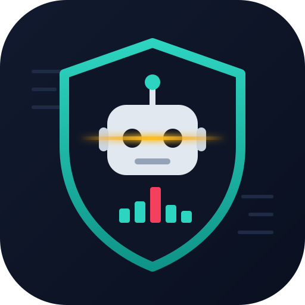

<p align="center"></p>

# bot-triage

An agent skill that finds and stops the bots, crawlers and vulnerability scanners
overloading a Linux web server, on any common stack.

Get it on [Agensi](https://www.agensi.io/skills/bot-triage) or clone this repo
(see [Install](#install)).

Ask your coding agent something like *"the server load is 30, find out what is
hitting it"* and it will:

1. check whether the load really comes from web traffic (not disk, backups or the database),
2. read the access logs and rank IPs, subnets, user agents, paths and attack signatures,
3. explain what it found in plain language,
4. propose blocks at the right layer for your stack, and apply only what you approve,
5. verify the load dropped and the site still works.

Works with nginx, Apache, LiteSpeed/OpenLiteSpeed and Caddy; cPanel, Plesk,
DirectAdmin, CyberPanel, HestiaCP or no panel; csf, Imunify360, ufw, firewalld,
nftables or iptables; with or without Cloudflare in front.

## What is inside

```
SKILL.md                 instructions the agent follows
scripts/detect-env.sh    detects OS, panel, web server in front, firewall
scripts/triage.sh        read-only markdown report from the access logs
scripts/ip-detail.sh     one IP in depth, with search-engine verification
scripts/gen-blocks.sh    prints block rules for your stack (never applies them)
references/              playbook, signatures, firewalls, web servers, Cloudflare WAF
tests/run.sh             self-contained tests on synthetic logs
```

The scripts need only bash and standard GNU tools (awk, sort, find, date, ss).
They are read-only: nothing changes on the server until you approve a proposed rule.

## Install

### From Agensi

bot-triage is listed on Agensi: <https://www.agensi.io/skills/bot-triage>

1. Open the listing and download the skill zip.
2. Unzip it into your agent's skills directory. For Claude Code:

   ```sh
   mkdir -p ~/.claude/skills/bot-triage
   unzip bot-triage.zip -d ~/.claude/skills/bot-triage
   ```

   For a single project only, use `.claude/skills/bot-triage` inside that project.
3. Start a new session. The skill loads automatically when you describe a load
   or bot problem, and you can also ask for it by name.

The zip has `SKILL.md` at its root, next to `scripts/` and `references/`, so it
unpacks straight into the skill folder.

### From GitHub

Claude Code (personal skill):

```sh
git clone https://github.com/nemke82/bot-triage ~/.claude/skills/bot-triage
```

Update later with `git -C ~/.claude/skills/bot-triage pull`.

### Other agents

Any agent that supports `SKILL.md` skills: copy the folder (or unzip the Agensi
download) into that agent's skills directory.

### Without an agent

The scripts also run by hand:

```sh
sudo bash scripts/triage.sh -m 15
sudo bash scripts/ip-detail.sh 203.0.113.7
bash scripts/gen-blocks.sh -i 203.0.113.7 -u ExampleBot -p /xmlrpc.php
```

## Examples

```sh
# last hour, custom log location
sudo bash scripts/triage.sh -m 60 -l /srv/www/logs

# logs from a container
docker logs web 2>&1 | bash scripts/triage.sh -l -

# replay a past incident window
sudo BOT_TRIAGE_NOW="2026-01-31 14:05" bash scripts/triage.sh -m 30

# rules for every supported target, behind Cloudflare
bash scripts/gen-blocks.sh -T all -C -i 198.51.100.0/24 -u ExampleBot
```

## Tests

```sh
bash tests/run.sh          # KEEP=1 keeps the generated logs and reports
```

Test data uses documentation IP ranges (RFC 5737) and example domains only.

## License

MIT, see [LICENSE](LICENSE).
